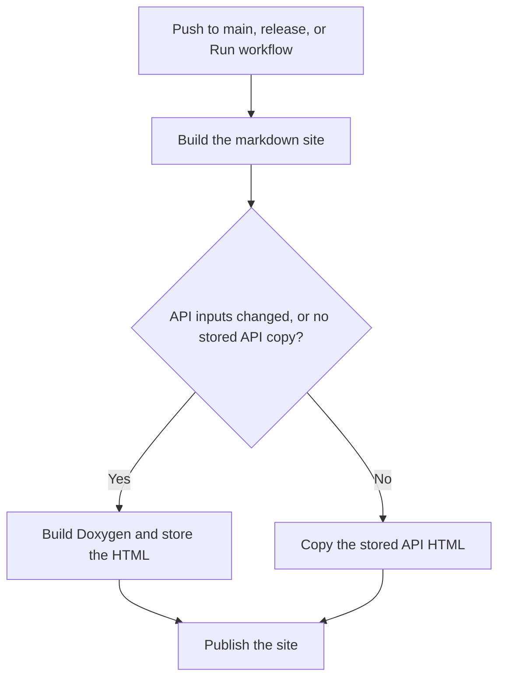

# How the website updates

**Author:** Mahima Ghosh

| [Home](../index.md) | [Developer Guide](development.md) | [Docs deploy troubleshooting](docs-deploy-troubleshooting.md) | [API](https://imperialchepi.github.io/healthgps/api/) |

A push to `main` publishes [the site](https://imperialchepi.github.io/healthgps/). A new page under `documentation/` does not need a manual **Run workflow**.

---

## What runs

| Change | Markdown site | API pages |
| ------ | ------------- | --------- |
| File under `documentation/` | Rebuilt | Previous copy, if one is stored |
| `src/`, root `README.md`, or `cmake/Doxygen.cmake` | Rebuilt | Rebuilt |
| Published release, or **Run workflow** | Rebuilt | Rebuilt |
| Anything else | Not published by this workflow | Not published by this workflow |

The stored API copy lasts 90 days. After that, the next documentation push builds Doxygen once and stores a new copy.

A new markdown file is on the site after that push. It shows up in the top link row only when a page's nav line includes it.

Pages takes a minute or two after the workflow is green.

---

## Phone layout

Wide columns apply from 961px upward. Narrower screens stack the sidebar and scroll wide tables. The desktop layout is unchanged.

---

**Author:** Mahima Ghosh
