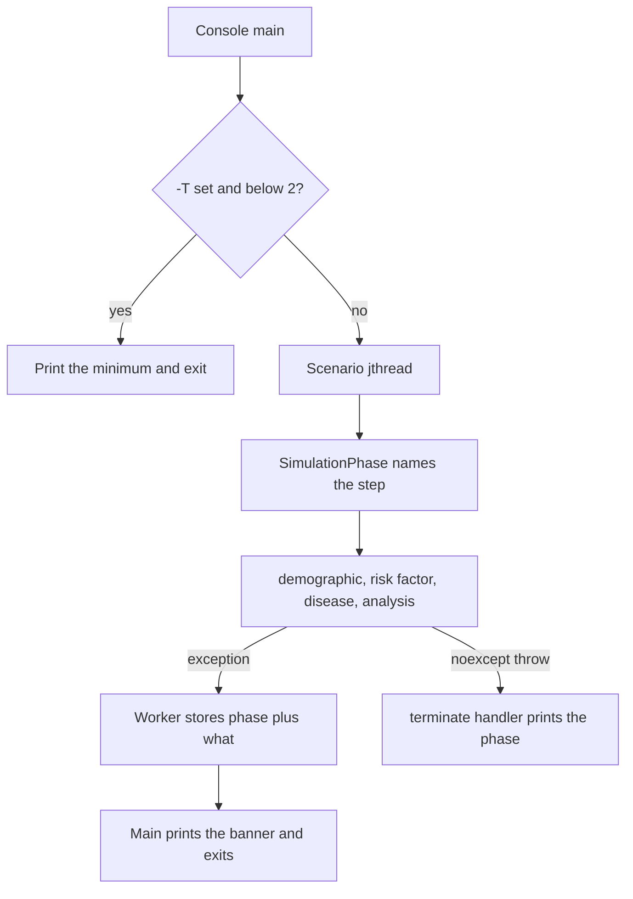

# When a Health-GPS run stops

**Author:** Mahima Ghosh

| [Home](../../index.md) | [Technical docs](../README.md) | [Performance](performance-optimizations.md) | [Slovenia run fixes](jacardi-slovenia-run-fixes.md) | [User Guide](../../user/userguide.md) |

A run that returns to the shell with no reason used to look like a hang that ended. The console now prints the step that was running and the exception text, then exits with a failure code.

---

## What you should see

```text
Health-GPS stopped during [scenario 'Baseline' run 1 > initialise_population > analysis].
Reason (std::out_of_range): Risk factor not found: bmi. It is not stored on this person (age 0, male). The input column may be entirely null, or the risk-factor model did not assign it.
```

That is the Slovenia Jacardi config: the BMI column is null on every input row, disease init finishes, then analysis asks for `bmi` and stops with the step name. The path is the nested step labels. The reason is the exception type and `what()`. The same banner is printed for a bad config and for `-T 1`.

`-T 0` still means no cap. Any other `-T` value must be at least 2. One thread is rejected before the simulation starts, because the info-event task and the tracking task need a second thread and the process otherwise stops with no result.

---

## Where a failure is reported



The scenario runs on a `std::jthread`. If that function throws, the C++ runtime calls `std::terminate` and the text never reaches `main`. The worker now stores the error and the joining thread rethrows it, so `main` can print it.

`SimulationPhase` is the label. If the scope is left by a throw, the label stays until the banner is built. A normal return restores the parent label.

---

## Messages that used to be useless

| Old text | What it means now |
| -------- | ----------------- |
| `map::at` / `invalid map key` on a disease cell | Disease code, age, and sex |
| Missing relative-risk age row | Factor key (for example `bmi`), age, sex, and value |
| Missing disease measure column | Disease code and column name |
| Physical activity or income not in the expected table | One warning with the lookup error, then that adjustment is skipped |
| Missing factor in the population summary | One warning per factor name, then that column is omitted |

Sex-limited diseases (cervical cancer, female-only) still skip the other sex. That skip is printed once at disease init as `EXPECTED`. See [Slovenia run fixes](jacardi-slovenia-run-fixes.md).

---

## Code

| Piece | File |
| ----- | ---- |
| Banner, phase label, `-T` check, terminate handler | `src/HealthGPS/failure_report.cpp` |
| Worker stores the error instead of dying on the thread | `src/HealthGPS/runner.cpp` |
| Step names around each module | `src/HealthGPS/simulation.cpp` |
| Step name per disease | `src/HealthGPS/disease.cpp` |
| Console always prints the banner | `src/HealthGPS.Console/program.cpp` |

Tests: `FailureReport.Test.cpp`, `RelativeRiskLookup.MissingAgeNamesTheAge`, `RelativeRiskLookup.RequireRelativeRiskNamesTheFactor`.

---

**Author:** Mahima Ghosh
