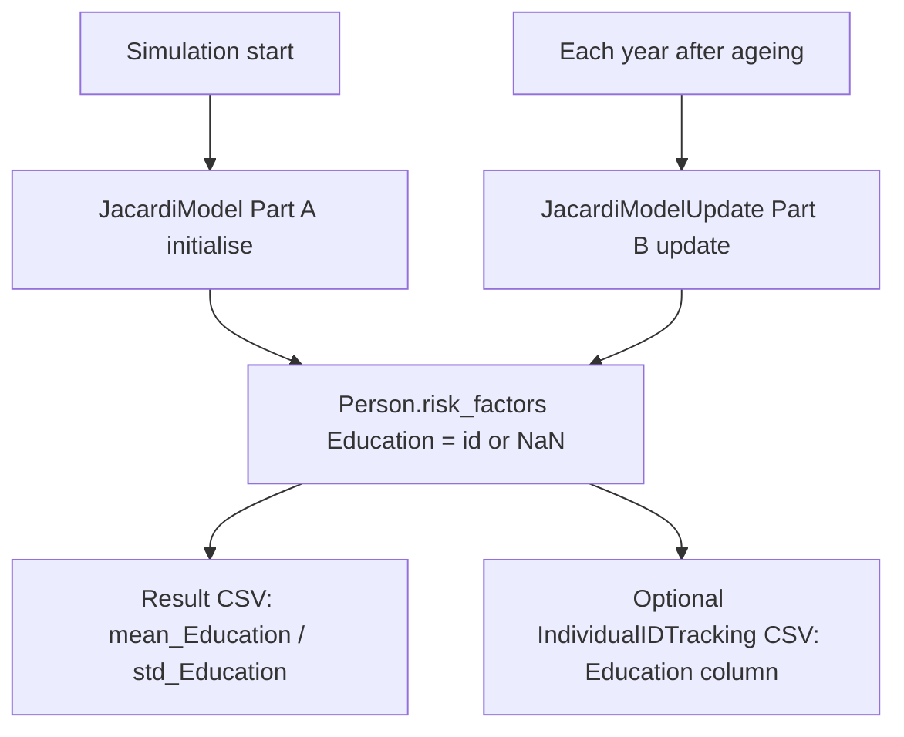
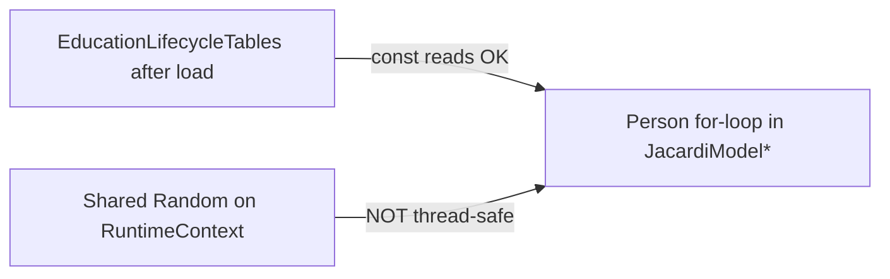

# JACARDI education lifecycle (logic, output, threading)

**Author:** Mahima Ghosh

| [Home](../../index.md) | [Technical docs](../README.md) | [JACARDI plan](../plans/JACARDI-7-countries-implementation-plan.md) | [Loader tests](jacardi-education-loader-tests.md) | [User output](../../user/userguide.md#output) |

How Slovenia-style education is assigned, how it reaches result CSVs, and whether we should parallelise.

---

## Mental model



| Phase | Model | When | What |
| ----- | ----- | ---- | ---- |
| Part A | `JacardiModel` (static) | Start year + anyone still missing Education | Age bands / lookup CSV |
| Part B | `JacardiModelUpdate` (dynamic) | Every year after age++ | Milestones only; otherwise hold |

Age thresholds are **named constants** in `EducationLifecycleTables` (`age_missing_max`, `age_draw`, …). Partners may retune them later — change the constants, re-run `Jacardi*` tests.

---

## Part A / Part B rules (current SI)

```text
Part A (initialise by age):
  0..5   → missing (NaN)
  6..18  → education_id 2
  19..21 → education_id 3
  22+    → draw from education_lookup.csv (age × gender)

Part B (update after ageing):
  0..5   → stay missing
  6      → set 2
  7..18  → hold
  19     → set 3
  20..21 → hold
  22     → redraw from education_draw_at_22_*.csv (year × gender)
  23..30 → upgrade from education_upgrade_transitions_*.csv (never go down)
  31+    → hold for life
```

CSV gender: **0 = female**, **1 = male**.

---

## Output CSV columns

Health-GPS result files get one `mean_<Factor>` / `std_<Factor>` pair **for every entry in** `modelling.risk_factors` in `config.json`.

To emit Education:

```json
"risk_factors": [
  { "name": "Education", "level": 1, "range": [1, 7] }
]
```

Then the main results CSV includes **`mean_Education`** and **`std_Education`** (sex × age rows).

| Detail | Behaviour |
| ------ | --------- |
| Ages 0–5 | Education is NaN on the person; analysis **skips** non-finite values. With no finite contributors, `mean_Education` / `std_Education` become NaN in-series and the **CSV writes `NA`** (not `0`, not `nan`). |
| Ages 6+ | Finite ids (1–7) contribute to the age×sex mean as usual. Real `std_Education = 0` (everyone same id) stays `0`. |
| Individual tracking | List `"Education"` under `output.individual_id_tracking.risk_factors`, or leave that list empty to take all mapping factors with `level > 0`. Missing/NaN cells are omitted (blank), not `"nan"`. |

Without `Education` in `modelling.risk_factors`, **no Education columns appear** — the engine only exports mapped factors.

---

## Thread safety / should we parallelise?



| Piece | Safe to share across threads? |
| ----- | ----------------------------- |
| Lookup / draw_at_22 / upgrade maps after load | **Yes** — read-only |
| `Person` fields (disjoint indices) | **Yes** if each thread owns distinct people |
| `context.random()` | **No** — single engine, no mutex |

**Decision:** keep education person loops **serial**. Per person work is O(1) (hash lookup + inverse-CDF draw). Runtime is dominated by disease / analysis / I/O, which already use `parallel_for` where safe. Parallelising education without thread-local RNG would race or need locks that cost more than they save.

When/if we parallelise: give each worker its own `Random` (seeded from a parent jump / splitmix), then `parallel_for` over population indices.

---

## Demographic status box

When `project_requirements.demographics.education` is true and `Education` is in `modelling.risk_factors`, the Demographic module console box shows:

```text
+- Education assignment --------------------------------------------------------+
|   Status             : enabled (lifecycle via JacardiModel / JacardiModelUpdate) |
```

(alongside Region / Ethnicity). Assignment itself is still done by Jacardi risk-factor models, not DemographicModule.

---

## Cost-of-disease `invalid stod` (Jacardi data pack)

`DataManager::load_cost_of_diseases` used to read hardcoded CSV columns `[6]=age`, `[8]=gender_id`, `[12]=mean` (France/UK layout). Jacardi `BoD705.csv` uses a different order — index 12 is the string `"All causes"`, so `std::stod` threw **`invalid stod argument`** while building the Analysis module.

**Fix:** map columns by name (`age`, `gender_id`, `mean`). Regression tests: `CostOfDiseaseSchema.*`.

Slovenia disease skip report / BoD / hierarchy notes: [jacardi-slovenia-run-fixes.md](jacardi-slovenia-run-fixes.md).

---

## Code map

| File | Role |
| ---- | ---- |
| `src/HealthGPS/jacardi_education_lifecycle.*` | Part A/B rules, CSV key packing, draw |
| `src/HealthGPS/jacardi_model.*` | Static slot — Part A generate/update |
| `src/HealthGPS/jacardi_model_update.*` | Dynamic slot — Part B yearly |
| `src/HealthGPS.Input/model_parser.cpp` | `load_jacardi_*` CSV loaders |
| `src/HealthGPS.Input/datamanager.cpp` | Cost-of-disease loader (named columns) |
| `src/HealthGPS/analysis_module.cpp` | Result CSV channels; skips non-finite Education; zero means → NaN for CSV `NA` |
| `src/HealthGPS.Console/result_file_writer.cpp` | Writes `NA` for non-finite CSV cells |
| `src/HealthGPS/demographic.cpp` | Console Education assignment status |
| `src/HealthGPS/disease.cpp` / `disease_table.cpp` | One-shot prevalence skip coverage report |

Tests: [jacardi-education-loader-tests.md](jacardi-education-loader-tests.md) (`--gtest_filter=Jacardi*`); also `CostOfDiseaseSchema*` / `DemographicSummary*` / `PrevalenceSkipCoverage*`.

---

**Author:** Mahima Ghosh
