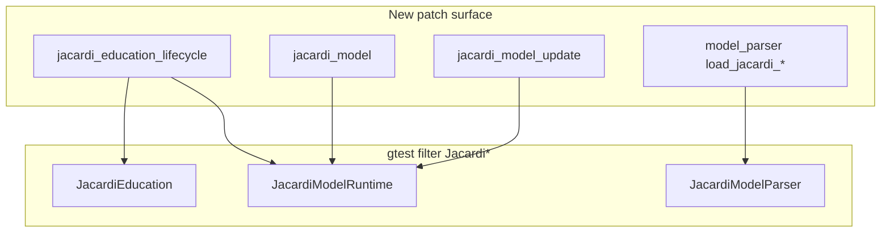
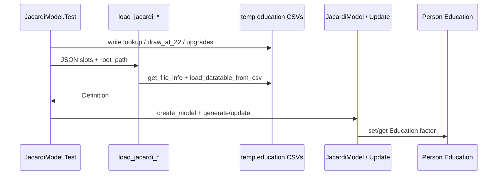

# JACARDI education loader and model tests

**Author:** Mahima Ghosh

| [Home](../../index.md) | [Technical docs](../README.md) | [JACARDI plan](../plans/JACARDI-7-countries-implementation-plan.md) | [Architecture](../../developer/architecture.md) | [Developer Guide](../../developer/development.md) |

Unit coverage for P0/P1a JACARDI loaders and education lifecycle — the patch Codecov tracks on `jacardi_model*`, `jacardi_education_lifecycle*`, and the `load_jacardi_*` paths in `model_parser.cpp`.

**Related:** [JACARDI education lifecycle](jacardi-education-lifecycle.md) · [JACARDI 7 countries plan](../plans/JACARDI-7-countries-implementation-plan.md) (§2 ModelNames, §3 CSV slots, §5 Slovenia education) · [Simulation models reference](simulation-models-reference.md)

---

## Why these tests



Without fixtures, Codecov saw mostly uncovered loader/model lines. These suites hit CSV slot load, throw paths, Part A init, and Part B update.

---

## Test files

| File | Suite | What it covers |
| ---- | ----- | -------------- |
| `src/HealthGPS.Tests/JacardiEducation.Test.cpp` | `JacardiEducation` | Age bands, draw mass, upgrade never-down, missing lookup/gender throws, person helpers |
| `src/HealthGPS.Tests/JacardiModel.Test.cpp` | `JacardiModelParser` / `JacardiModelRuntime` | `load_jacardi_*` from temp CSV slots; static generate/update; dynamic Part B |

CMake: both listed in `src/HealthGPS.Tests/CMakeLists.txt`.

---

## Coverage map (P1a)



| Behaviour | Test |
| --------- | ---- |
| Static JSON + `Education.lookup` loads | `JacardiModelParser.LoadsStaticDefinitionFromCsvSlots` |
| Update JSON + `draw_at_22` + `upgrade_transitions` loads | `JacardiModelParser.LoadsUpdateDefinitionFromCsvSlots` |
| Missing Education block throws | `StaticMissingEducationThrows` / `UpdateMissingEducationThrows` |
| Part A age bands (missing / 2 / 3 / lookup) | `GenerateAssignsEducationByAge` |
| Static update fills missing only | `StaticUpdateFillsMissingEducationOnly` |
| Part B age 6 → 2; age 22 draw; age 25 upgrade | `DynamicUpdateAppliesPartB` |
| Lifecycle edges without I/O | `JacardiEducation.*` |

Gender codes in CSVs: **0 = female**, **1 = male** (same as `EducationLifecycleTables::gender_code`).

---

## How to run

```powershell
cmake --build out/build/windows-release --target HealthGPS.Tests -j 8
.\out\build\windows-release\src\HealthGPS.Tests\HealthGPS.Tests.exe --gtest_filter=Jacardi*
```

Expect **18** tests in three suites (`JacardiEducation`, `JacardiModelParser`, `JacardiModelRuntime`).

---

## Out of scope (for now)

- P1b ladder coefficient CSV loaders
- Full Slovenia pack dry-run / schema validation E2E
- France / India / FINCH regression (separate existing suites)

---

**Author:** Mahima Ghosh
