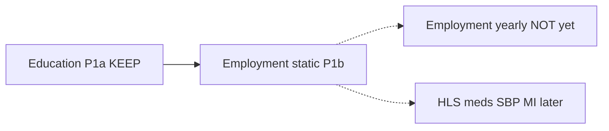
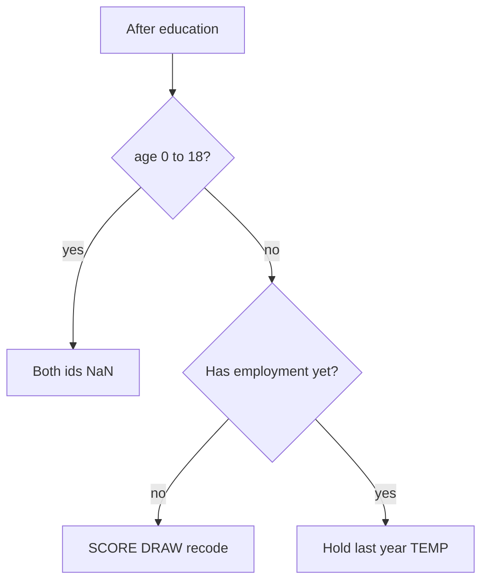

# JACARDI Slovenia employment — plan and technical guide

**Author:** Mahima Ghosh

| [Home](../../index.md) | [Technical docs](../README.md) | [JACARDI 7-country plan](../plans/JACARDI-7-countries-implementation-plan.md) | [Slovenia education](jacardi-slovenia-education.md) | [Slovenia run fixes](jacardi-slovenia-run-fixes.md) |

I keep Slovenia employment static in **this single document**: algorithm (partner **16 October 2026**), pack files, engine wiring, tests, config checklist, and plan status. Education is separate — [jacardi-slovenia-education.md](jacardi-slovenia-education.md).

Partner source in the examples pack: `EMPLOYMENT_STATIC_ALGORITHM.md`. Keep all three education CSVs.

**Status:** P1b static **done** (engine + tests). Yearly employment transitions still pending (Part B hold is temporary).

---

## 1. Where employment sits

| Phase | Work | Status |
| ----- | ---- | ------ |
| P1a | Slovenia education (15 Oct) | Done — [education guide](jacardi-slovenia-education.md) |
| **P1b** | **Employment static (this doc)** | **Done** — yearly hold still temporary |
| Later | Yearly employment transitions | Replaces Part B step 3 only |
| Later | HLS → … → MI | Separate CSV deliveries |

Employment needs **age, gender, and education_id** — always runs **after** education.



---

## 2. Pack files

| File | Role | Runtime? |
| ---- | ---- | -------- |
| `employment_static_coefs.csv` | Multinomial logit: Category × Factor × Coefficient | Yes — SCORE |
| `employment_4cat_recode.csv` | Map employment_id 1–6 → employment4_id 1–4 (“4cat” = four categories) | Yes — after every draw |
| `employment_static_check.csv` | Golden `p_1`…`p_6` / `q_1`…`q_4` | Tests only (same Slovenia pack) |
| `EMPLOYMENT_STATIC_ALGORITHM.md` | Partner rules | Docs |

Do **not** delete education CSVs when employment arrives.

---

## 3. Two ids per person

Both missing below age 19 (NaN on `Person.risk_factors`).

| Engine name | Range | Role |
| ----------- | ----- | ---- |
| `EmploymentDetailed` | 1–6 | Drawn; kept for future yearly package |
| `Employment` | 1–4 | Recoded; health models and primary output |

| employment_id | Detailed | employment4_id | 4-category |
| ------------- | -------- | -------------- | ---------- |
| 1 | Employed | 1 | Employed |
| 2 | Unemployed | 2 | Unemployed |
| 3 | Retired | 4 | Not in labour force |
| 4 | Unable to work (health) | 4 | Not in labour force |
| 5 | Student | 3 | Student |
| 6 | Domestic / other inactive | 4 | Not in labour force |

CSV gender: **0 = female**, **1 = male**. Education ids **1–7**.

---

## 4. SCORE / DRAW / Part A / Part B

### Predictors

Age `a` capped at **80**:

- `Intercept`, `Age`, `AgeRcs1`…`AgeRcs5` (knots 21, 24, 28, 43, 55, 66, 80)
- `SchoolFade` = max(0, 22 − a) / 3 (ages 19–21)
- `Gender`; education dummies (ISCED 3 = reference)
- Interactions e.g. `Age*Gender`, `EducationISCED2*SchoolFade`

Golden RCS at a = 60: 17.0408, 13.4030, 9.4134, 1.4114, 0.0359.

### SCORE / DRAW

Linear score per category → softmax → six probs (same idea as categorical income). Inverse-CDF draw over 1…6; then recode.

### Part A (start)

| Age | Rule |
| --- | ---- |
| 0–18 | missing |
| 19+ | SCORE → DRAW → recode |

### Part B (yearly, until yearly package)

1. Under 19 → missing
2. No status yet and age 19+ → same as Part A
3. Everyone else → **hold last year** (TEMPORARY; swappable)



Births: missing until 19. Immigration clones: copy both ids; no redraw.

---

## 5. Engine wiring

| Piece | Role |
| ----- | ---- |
| `jacardi_employment_static.*` | RCS / SchoolFade / SCORE / DRAW / recode / Part A+B hold |
| `jacardi_model.*` | After education Part A → employment Part A |
| `jacardi_model_update.*` | After education Part B → employment Part B |
| `model_parser.cpp` | Opt-in Education and/or Employment CSV slots |
| Schemas `jacardimodel*.json` | If a step is present, its filenames are required |

```json
"Employment": {
  "method": "multinomial_static",
  "coefficients": { "name": "employment_static_coefs.csv", "format": "csv", "delimiter": ",", "encoding": "ASCII", "columns": { "Category": "integer", "Factor": "string", "Coefficient": "double" } },
  "recode": { "name": "employment_4cat_recode.csv", "format": "csv", "delimiter": ",", "encoding": "ASCII", "columns": { "employment_id": "integer", "employment4_id": "integer" } }
}
```

```json
"risk_factors": [
  { "name": "Education", "level": 1, "range": [1, 7] },
  { "name": "EmploymentDetailed", "level": 2, "range": [1, 6] },
  { "name": "Employment", "level": 2, "range": [1, 4] }
]
```

Shared `context.random()` is not thread-safe — person loops stay **serial**.

Older sketch (`logistic` + `employment_coefs.csv` + age²) is **outdated**.

---

## 6. Tests

| Suite | Covers |
| ----- | ------ |
| `JacardiEmployment` | RCS at 60; woman 19 edu 2 → p_5 ≈ 0.879; check CSV SCORE; missing/hold/recode |
| `Jacardi*` | Education + model runtime regression |

SCORE tests read CSVs from **`healthgps-examples/Jacardi_Slovenia/`** (sibling checkout; override with
`-DJACARDI_SLOVENIA_DIR=...`). AgeRcs / SchoolFade do not need the pack; if the pack is missing,
CSV tests `GTEST_SKIP` in the test body (not a helper — `GTEST_SKIP` only returns from the
current function) and CMake only warns (configure still succeeds). CI has no examples checkout,
so those five tests skip there; locally with the sibling pack they run and check SCORE.

```powershell
cmake --build out/build/windows-release --target HealthGPS.Tests -j 8
.\out\build\windows-release\src\HealthGPS.Tests\HealthGPS.Tests.exe --gtest_filter=Jacardi*
```

---

## 7. Work items (P1b)

| Status | Item |
| ------ | ---- |
| Done | Helper `jacardi_employment_static.*` |
| Done | Parser + schema Employment slots |
| Done | Wire after education in JacardiModel / Update |
| Done | Gtests + check CSV fixture |
| Done | Slovenia pack Employment JSON + CSVs |
| Later | Yearly employment transitions (replace hold) |

### Out of scope for P1b

- Yearly transitions; HLS / meds / SBP / MI
- Country `if`s; coefficients as numbers in JSON
- Trusting employment trends while Part B is still hold

---

## 8. Config checklist

1. `jacardi_model.json` → Employment `multinomial_static` + coefficients + recode
2. `jacardi_model_update.json` → same Employment slots
3. `modelling.risk_factors` lists `EmploymentDetailed` and `Employment`
4. Coefs + recode CSVs on disk in the pack
5. Education CSVs still present

---

**Author:** Mahima Ghosh
