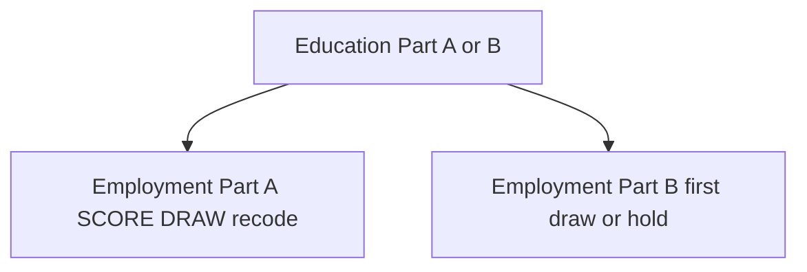

# JACARDI Slovenia employment (static package, 16 Oct 2026)

**Author:** Mahima Ghosh

| [Home](../../index.md) | [Technical docs](../README.md) | [JACARDI 7-country plan](../plans/JACARDI-7-countries-implementation-plan.md) | [Employment init plan (P1b)](../plans/JACARDI-employment-init.md) | [Slovenia education](jacardi-slovenia-education.md) |

**Implementation plan:** [JACARDI-employment-init.md](../plans/JACARDI-employment-init.md)

Partner algorithm (examples pack): `healthgps-examples/Jacardi_Slovenia/EMPLOYMENT_STATIC_ALGORITHM.md`.

**These files are not education.** They are the next ladder step after Education. Keep all three education CSVs.

---

## 1. Where employment sits

| Level | Variable | Status |
| ----- | -------- | ------ |
| 1 | Education | Done (P1a) |
| 2 | **EmploymentDetailed** (1–6) + **Employment** (1–4) | **Done (P1b static)** |
| 3+ | HLS … MI | Later |



---

## 2. Pack files

| File | Role | Runtime? |
| ---- | ---- | -------- |
| `employment_static_coefs.csv` | Multinomial SCORE coefs | Yes |
| `employment_4cat_recode.csv` | Map id 1–6 → 4-cat id 1–4 | Yes |
| `employment_static_check.csv` | Golden `p_1`…`p_6` | Tests only (under `src/HealthGPS.Tests/data/jacardi/employment/`) |
| `EMPLOYMENT_STATIC_ALGORITHM.md` | Partner rules | Docs |

---

## 3. Algorithm (plain language)

1. Ages **0–18**: both ids missing (NaN).
2. Ages **19+**: SCORE (age capped 80, RCS, SchoolFade, education dummies) → DRAW `employment_id` 1–6 → recode to `Employment` 1–4.
3. Part B: under 19 missing; first time at 19+ same as Part A; else **hold** (temporary until yearly package).

| employment_id | Detailed | employment4_id | 4-cat |
| ------------- | -------- | -------------- | ----- |
| 1 | Employed | 1 | Employed |
| 2 | Unemployed | 2 | Unemployed |
| 3 | Retired | 4 | Not in labour force |
| 4 | Unable to work (health) | 4 | Not in labour force |
| 5 | Student | 3 | Student |
| 6 | Domestic / other inactive | 4 | Not in labour force |

Newborns: missing until 19. Immigration clones: copy both ids; no redraw.

---

## 4. Engine wiring

| Piece | Role |
| ----- | ---- |
| `jacardi_employment_static.*` | RCS / SchoolFade / SCORE / DRAW / recode / Part A+B hold |
| `jacardi_model.*` | After education Part A → employment Part A |
| `jacardi_model_update.*` | After education Part B → employment Part B |
| `model_parser.cpp` | Opt-in `Education` and/or `Employment` CSV slots |

```json
"risk_factors": [
  { "name": "Education", "level": 1, "range": [1, 7] },
  { "name": "EmploymentDetailed", "level": 2, "range": [1, 6] },
  { "name": "Employment", "level": 2, "range": [1, 4] }
]
```

Shared `context.random()` is not thread-safe — person loops stay **serial**.

---

## 5. Tests

| Suite | Covers |
| ----- | ------ |
| `JacardiEmployment` | RCS at 60; woman 19 edu 2 → p_5 ≈ 0.879; check CSV SCORE; missing/hold/recode; employment-only parser |
| `Jacardi*` | Education + model runtime regression |

```powershell
cmake --build out/build/windows-release --target HealthGPS.Tests -j 8
.\out\build\windows-release\src\HealthGPS.Tests\HealthGPS.Tests.exe --gtest_filter=Jacardi*
```

---

## 6. Config checklist

1. `jacardi_model.json` → `Employment.method` = `multinomial_static` + `coefficients` + `recode`
2. `jacardi_model_update.json` → same Employment slots (first draw + hold)
3. `modelling.risk_factors` lists `EmploymentDetailed` and `Employment`
4. Coefs + recode CSVs present in the pack
5. Schema: ladder steps opt-in; if Employment is present, its filenames are required

---

**Author:** Mahima Ghosh
