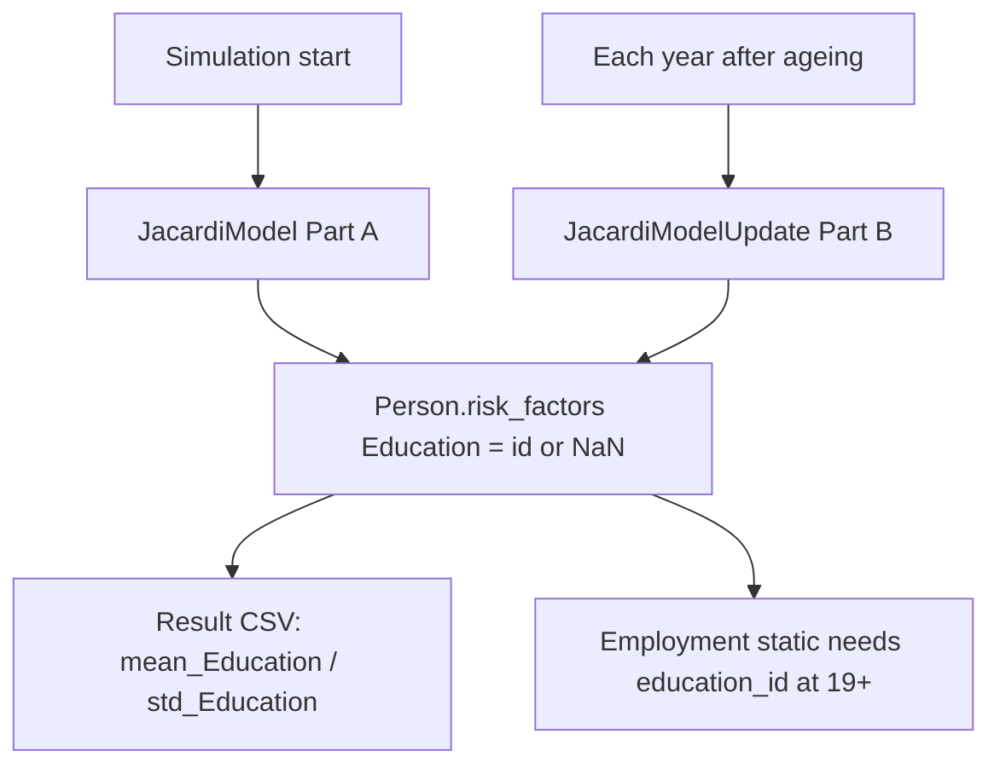

# JACARDI Slovenia education — plan and technical guide

**Author:** Mahima Ghosh

| [Home](../../index.md) | [Technical docs](../README.md) | [JACARDI 7-country plan](../plans/JACARDI-7-countries-implementation-plan.md) | [User output](../../user/userguide.md#output) | [Employment static (next ladder step)](jacardi-employment-static.md) |

I keep Slovenia education in **this single document**: algorithm (partner **15 October 2026**), pack files, engine wiring, CSV output, tests, and plan. Employment is separate — [jacardi-employment-static.md](jacardi-employment-static.md).

Partner source in the examples pack: `EDUCATION_ALGORITHM.md` (replaces 29 September 2026).

---

## 1. Where education sits in the ladder

I assign risk factors in level order from `modelling.risk_factors`. Education is level 1, after age/sex from UNDB.

| Level | Order | Variable | Status for Slovenia |
| ----- | ----- | -------- | ------------------- |
| 0 | 1 | Age / Sex | DemographicModule / UNDB |
| 1 | 2 | **Education** | **This guide (15 Oct rules)** |
| 2 | 3 | Employment | P1b — after education at 19+ |
| 3+ | 4… | HLS … MI | Later ladder steps |



---

## 2. Pack files I use (15 Oct 2026)

In `healthgps-examples/Jacardi_Slovenia/`:

| File | Role |
| ---- | ---- |
| `education_lookup.csv` | Part A ages **19–110** × gender |
| `education_draw_at_19_ssp2.csv` | Part B at age **19**: year × gender |
| `education_upgrade_transitions_ssp2.csv` | Part B ages **20–30**: year × age × gender × from_id |
| `EDUCATION_ALGORITHM.md` | Partner rules |

I no longer use `education_draw_at_22_ssp2.csv` (superseded).

Host slots: `jacardi_model.json` → `Education.lookup`; `jacardi_model_update.json` → **`draw_at_19`** + `upgrade_transitions` (optional `lookup` for rare 20+ missing fill).

CSV gender: **0 = female**, **1 = male**. Education ids **1–7**.

---

## 3. What changed vs 29 September

| Setting | Old (29 Sep / prior engine) | New (15 Oct) |
| ------- | --------------------------- | ------------ |
| Missing ages | 0–5 | **0–18** |
| Fixed id 2 at 6–18 | yes | **removed** |
| Fixed id 3 at 19–21 | yes | **removed** |
| Draw age | 22 | **19** |
| Draw file | `education_draw_at_22_ssp2.csv` | **`education_draw_at_19_ssp2.csv`** |
| Upgrades | 23–30 | **20–30** |
| Lookup ages | 22–110 | **19–110** |
| Fixed for life | 31+ | 31+ (unchanged) |

---

## 4. Part A / Part B rules (current SI)

Constants in `EducationLifecycleTables`: `age_missing_max = 18`, `age_draw = 19`, `age_upgrade_max = 30`.

```text
Part A (JacardiModel — start year / still-missing Education):
  0..18  → missing (NaN)
  19+    → DRAW from education_lookup.csv (age capped at 110)

Part B (JacardiModelUpdate — every year after age++):
  0..18  → stay missing
  19     → DRAW from education_draw_at_19_*.csv (year × gender)
  20..30 → upgrade transitions (never go down); if no rows, hold
  31+    → hold for life
```

If someone is 19+ but still missing (should be rare): Part A lookup when that table is on the tables object; otherwise Part B at 19 uses `draw_at_19`.

Births enter missing at age 0. Immigration clones copy Education; I do not redraw.

---

## 5. Engine wiring I use

| Piece | Role |
| ----- | ---- |
| `jacardi_education_lifecycle.*` | Part A/B rules, CSV key packing, inverse-CDF draw |
| `jacardi_model.*` | Static slot — Part A generate / fill-missing update |
| `jacardi_model_update.*` | Dynamic slot — Part B yearly |
| `model_parser.cpp` `load_jacardi_*` | Load CSV slots (`draw_at_19`, upgrades) |
| `demographic.cpp` | Console Education box when project_requirements says so |
| `analysis_module.cpp` | Means/std; skip non-finite; zero mean → NaN for CSV `NA` |
| `result_file_writer.cpp` | Writes `NA` for non-finite CSV cells |

```json
"risk_factors": [
  { "name": "Education", "level": 1, "range": [1, 7] }
]
```

| Output detail | Behaviour I ship |
| ------------- | ---------------- |
| Ages 0–18 | Person Education NaN; no finite contributors → CSV **`NA`** |
| Ages 19+ | Finite ids 1–7 enter the mean; real `std_Education = 0` stays `0` |

Shared `context.random()` is not thread-safe — education person loops stay **serial**.

---

## 6. Tests and how I run them

| File | Suite | Covers |
| ---- | ----- | ------ |
| `JacardiEducation.Test.cpp` | `JacardiEducation` | Missing 0–18, draw at 19, upgrades 20–30, never-down |
| `JacardiModel.Test.cpp` | `JacardiModelParser` / `JacardiModelRuntime` | `draw_at_19` slot load; Part A/B runtime |
| `ResultFileWriter.Test.cpp` | `ZeroEducation*` / `CsvWritesNa*` | Zero mean → NaN; CSV `NA` |

```powershell
cmake --build out/build/windows-release --target HealthGPS.Tests -j 8
.\out\build\windows-release\src\HealthGPS.Tests\HealthGPS.Tests.exe --gtest_filter=Jacardi*
```

---

## 7. Plan — done vs next

| Phase | What I do | Gate |
| ----- | --------- | ---- |
| **Education 15 Oct** | Missing 0–18; draw at 19; upgrades 20–30; new CSVs + `draw_at_19` slot | Green `Jacardi*` + Slovenia smoke |
| **P1b (next)** | Employment static after education | See employment guide |
| Later | HLS → … → MI | Per ladder CSV deliveries |

Models that use education should apply to people aged **19+** until partners optionally add under-19 values (e.g. mother’s education).

---

## 8. Config checklist

1. `jacardi_model.json` → `Education.lookup` → `education_lookup.csv`
2. `jacardi_model_update.json` → `Education.draw_at_19` → `education_draw_at_19_ssp2.csv` + `upgrade_transitions` (+ optional `lookup`)
3. `modelling.risk_factors` includes Education at level 1
4. Updated lookup / draw19 / upgrade CSVs present in the pack
5. Schema slot name is `draw_at_19` (not the old `draw_at_22`)

---

**Author:** Mahima Ghosh
