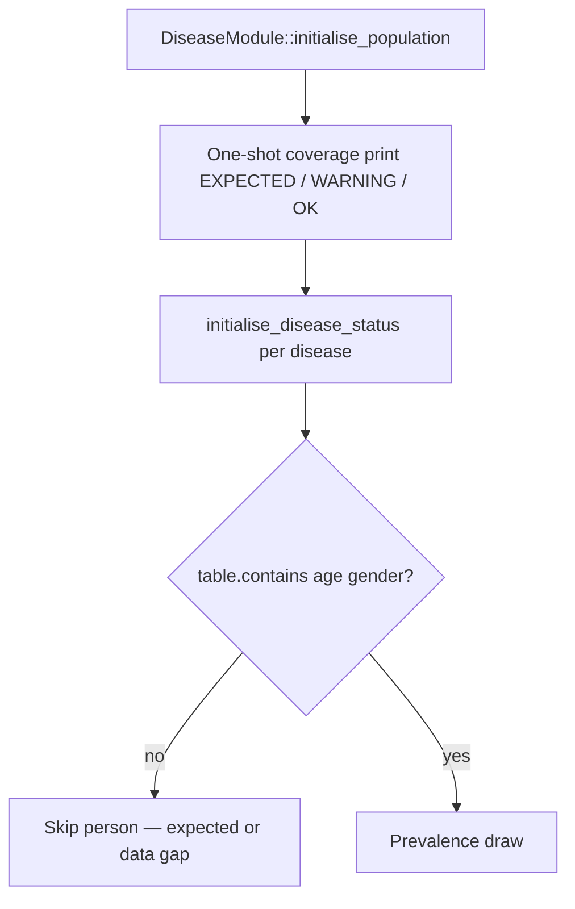

# JACARDI Slovenia run fixes

**Author:** Mahima Ghosh

| [Home](../../index.md) | [Technical docs](../README.md) | [JACARDI plan](../plans/JACARDI-7-countries-implementation-plan.md) | [Education lifecycle](jacardi-education-lifecycle.md) | [Loader tests](jacardi-education-loader-tests.md) |

Fixes and diagnostics for Jacardi Slovenia console runs. **BMI / LMS behaviour is unchanged** — BMI is a Jacardi hierarchy variable (level 5), not something analysis soft-fills.

---

## Jacardi Slovenia risk-factor order (do not short-circuit)

| Level | Order | Variable | Source / equation |
| ----- | ----- | -------- | ----------------- |
| 0 | 1 | Age / Sex | UNDB |
| 1 | 2 | Education status | National Slovenian dataset (Part A/B lifecycle) |
| 2 | 3 | Employment | age + age² + sex + education |
| 3 | 4 | HLS | age + age² + sex + education + employment |
| 4 | 5 | Smoking | age + age² + sex + education + employment |
| 4 | 6 | Physical activity | … + smoking |
| 5 | 7 | BMI | … + smoking + physical activity |
| 5 | 8 | Medication adherence | … + HLS |
| 6 | 9 | SBP | … + smoking + BMI + medication |
| 7 | 10 | MI status | age + age² + sex + BMI + SBP + smoking |

Input CSV nulls for BMI (etc.) are expected until Jacardi model equations assign them. Do **not** patch LMS / analysis to invent or skip BMI.

---

## Disease prevalence skip report (one-shot)

Before any prevalence loop, `DiseaseModule` prints **once** which diseases will skip age×sex cells and **why**:

```text
Disease prevalence coverage (printed once at disease init):
  cervicalcancer : EXPECTED - female-only table; males skipped ...
  colorectalcancer : OK - both sexes covered; contiguous ages [0, 110] ...
  diabetes : WARNING - both sexes present but N age row(s) missing ...
```

Console strings use ASCII `-` only (UTF-8 em dash shows as `ÔÇö` on some Windows consoles).

| Tag | Meaning |
| --- | ------- |
| `EXPECTED` | Sex-limited disease (e.g. cervical = female-only CSV) — skip is correct |
| `WARNING` | Age rows missing inside the table’s `[min, max]` span — likely **CSV gap** |
| `ERROR` | Empty prevalence table |
| `OK` | Both sexes, contiguous ages |

Per-person skips still use `DiseaseTable::contains(age, gender)` (no crash on female-only rows).

Regression: `TestHealthGPS_Disease.PrevalenceSkipCoverage*`.

---

## Other Slovenia load fixes

| Symptom | Root cause | Fix |
| ------- | ---------- | --- |
| `invalid stod` building Analysis | BoD705 column order ≠ France indices | Named columns `age` / `gender_id` / `mean` |
| Abort in cervical prevalence | Female-only CSV × male persons | `contains(age, gender)` skip + coverage report |



Education NaN / CSV means: [jacardi-education-lifecycle.md](jacardi-education-lifecycle.md).

---

**Author:** Mahima Ghosh
