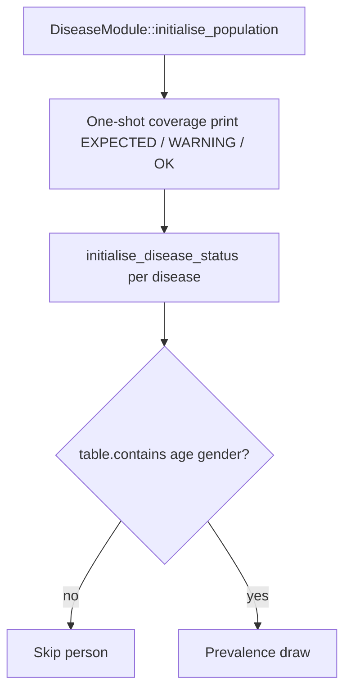

# JACARDI Slovenia run fixes (disease / BoD)

**Author:** Mahima Ghosh

| [Home](../../index.md) | [Technical docs](../README.md) | [JACARDI plan](../plans/JACARDI-7-countries-implementation-plan.md) | [Slovenia education (single guide)](jacardi-slovenia-education.md) |

I keep disease and BoD diagnostics here. Education algorithm, output `NA`, tests, and plan live only in [jacardi-slovenia-education.md](jacardi-slovenia-education.md).

---

## Disease prevalence skip report (one-shot)

Before any prevalence loop, `DiseaseModule` prints **once** which diseases will skip age×sex cells and why:

```text
Disease prevalence coverage (printed once at disease init):
  cervicalcancer : EXPECTED - female-only table; males skipped ...
  colorectalcancer : OK - both sexes covered; contiguous ages [0, 110] ...
  diabetes : WARNING - both sexes present but N age row(s) missing ...
```

Console strings use ASCII `-` only (UTF-8 em dash shows as `ÔÇö` on some Windows consoles).

| Tag | Meaning |
| --- | ------- |
| `EXPECTED` | Sex-limited disease (e.g. cervical = female-only CSV) - skip is correct |
| `WARNING` | Age rows missing inside the table's `[min, max]` span - likely CSV gap |
| `ERROR` | Empty prevalence table |
| `OK` | Both sexes, contiguous ages |

Per-person skips use `DiseaseTable::contains(age, gender)`. Regression: `TestHealthGPS_Disease.PrevalenceSkipCoverage*`.



---

## BoD named columns

| Symptom | Root cause | Fix |
| ------- | ---------- | --- |
| `invalid stod` building Analysis | Jacardi `BoD705` column order ≠ France indices | Named columns `age` / `gender_id` / `mean` |
| Abort in cervical prevalence | Female-only CSV × male persons | `contains(age, gender)` skip + coverage report |

---

**Author:** Mahima Ghosh
