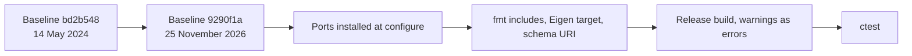

# vcpkg baseline, November 2026

**Author:** Mahima Ghosh

| [Technical docs](../README.md) | [Developer Guide](../../developer/development.md) | [MSVC troubleshooting](../../developer/msvc-windows-build-troubleshooting.md) |

The registry pin in `vcpkg.json` moved from the 14 May 2024 commit to the 25 November 2026 commit. The Health-GPS manifest version stays `1.2.2.0`. That string is the last release tag, not the dependency pin.

---

## What moved



`vcpkg-configuration.json` on a machine that has one must use the same baseline. vcpkg uses that file instead of `builtin-baseline` when both are present.

| Port | May 2024 | November 2026 |
| ---- | -------- | ------------- |
| fmt | 10.2.1 | 12.2.1 |
| eigen3 | 3.4.0 | 5.0.1 |
| jsoncons | 0.175.0 | 1.9.0 |
| tbb | 2021.11.0 | 2023.2.0 |
| openssl | 3.3.0 | 3.6.5 |
| curl | 8.7.1 | 8.23.0 |
| gtest | 1.14.0 | 1.18.0 |
| nlohmann-json | 3.11.3 | 3.12.0 |
| rapidcsv | 8.80 | 9.07 |
| cxxopts | 3.2.1 | 3.3.1 |
| platform-folders | 4.2.0 | 4.3.0 |
| libzip | 1.10.1 | 1.11.4 |
| libzippp | 7.1-1.10.1 | 7.1-1.10.1 |
| curlpp | 2018-06-15 | 2018-06-15 |
| crossguid | 2021-10-22 | 2021-10-22 |

curlpp and crossguid did not publish a newer port. They are still rebuilt against the newer curl and the current compiler.

---

## Source changes that keep the new ports compiling

fmt 12 no longer exports `fmt::format` from `fmt/core.h`, and `fmt::join` lives in `fmt/ranges.h`. A call that passed `e.what()` as the format string is now `"{}"` plus the message, because the format string has to be a compile-time constant.

Eigen 5 headers are under `include/eigen3`. `HealthGPS` links `Eigen3::Eigen` so `#include <Eigen/Dense>` resolves. The calls in use are `MatrixXd`, `VectorXd`, `LLT`, and `NullaryExpr`. Those APIs are unchanged.

jsoncons 1.9 passes the JSON pointer fragment on a schema `$ref`. `strip_schema_fragment` drops the `#...` part before the file is opened. `SchemaUri` tests cover a URI with no fragment, a pointer fragment, and an empty fragment.

oneTBB 2023 worker threads abort or never return while gtest has redirected stdout. The Kevin Hall weight tests do that capture. `capture_stdout` limits TBB to one thread for the captured call only. The simulation still uses the normal worker count. A weight-range warning that used `std::osyncstream` now uses `std::cout`, because that stream buffer blocks under the same redirect.

---

## Rebuild

Configure again after pulling. The first configure compiles the ports. OpenSSL and hwloc dominate that time on Windows.

```text
cmake --preset windows-release
cmake --build --preset release-build-windows
ctest --preset core-test-windows --output-on-failure
```

The preset test target is the debug build. The check for this bump was a Release build with `-DWARNINGS_AS_ERRORS=ON`, then `ctest` in `out/build/vcpkg-baseline-202611`. 519 tests passed. Two disease-module scenarios were skipped, the same two as before this bump.

---

**Author:** Mahima Ghosh
