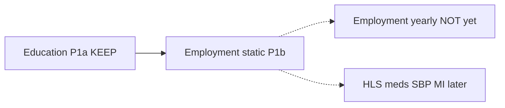
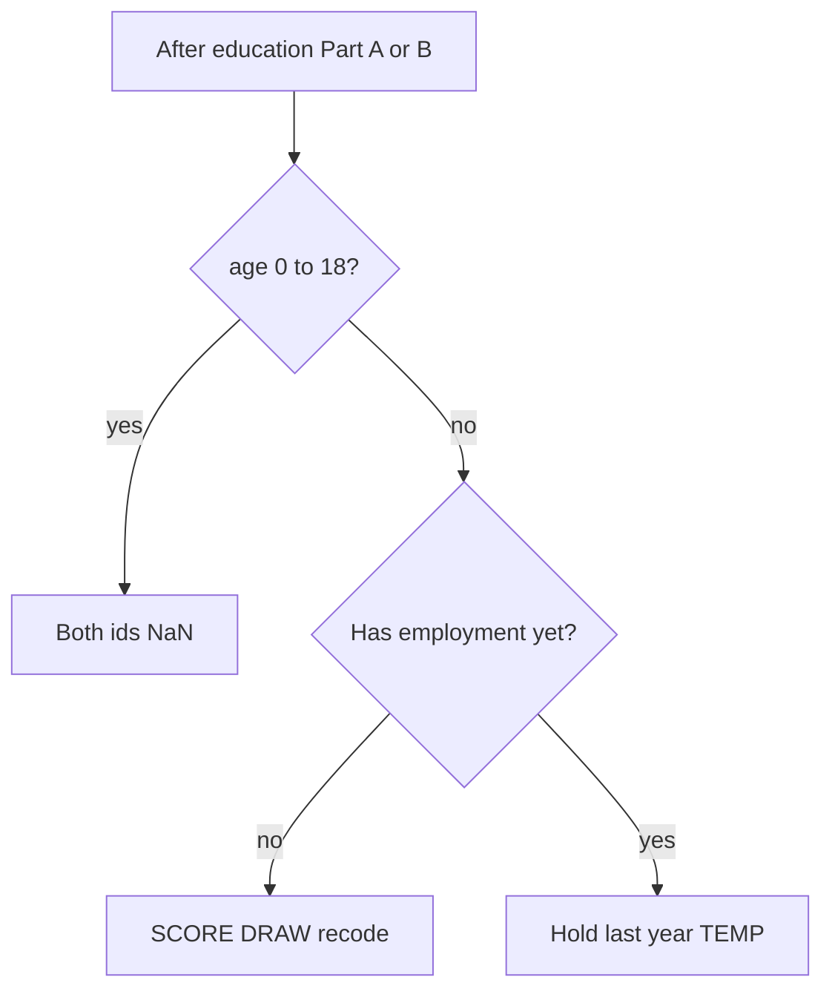

# JACARDI — Slovenia employment static (P1b)

## Global Health Policy Simulation model

| [Home](../../index.md) | [Quick Start](../../user/getstarted.md) | [User Guide](../../user/userguide.md) | [Schemas](../../user/schemas.md) | [Models](../../user/models-overview.md) | [Architecture](../../developer/architecture.md) | [Data Model](../../developer/datamodel.md) | [Developer Guide](../../developer/development.md) | [Technical docs](../README.md) | [API](https://imperialchepi.github.io/healthgps/api/) |

**Author:** Mahima Ghosh · **GitHub:** `jacardi` · **Branch prefix:** `jacardi/`
**Status:** Design / planning (written and maintained by Mahima) 

**Related:** [Technical index](../README.md) · [JACARDI 7 countries](JACARDI-7-countries-implementation-plan.md) · [Slovenia education guide](../guides/jacardi-slovenia-education.md) · [Employment static guide](../guides/jacardi-employment-static.md) · [Slovenia run fixes](../guides/jacardi-slovenia-run-fixes.md) · [Project requirements](project-requirements-plan.md) · [JACARDI-UKPDS-healthGPS](JACARDI-UKPDS-healthGPS.md)

**Goal:** Add Slovenia **employment static** (first assignment) as the next ladder step after education in `JacardiModel` / `JacardiModelUpdate`. Multinomial SCORE → DRAW detailed id → recode to 4 categories. Keep education CSVs and code as-is. Temporary Part B hold until the yearly employment package arrives.

Partner algorithm (examples pack): `EMPLOYMENT_STATIC_ALGORITHM.md` (16 October 2026). CSV filenames stay as delivered until Mahima renames them manually.

---


## 1. Where this sits


| Phase   | Work                                       | Status                                                                |
| ------- | ------------------------------------------ | --------------------------------------------------------------------- |
| P1a     | Slovenia education (15 Oct rules)          | Done — see [education guide](../guides/jacardi-slovenia-education.md) |
| **P1b** | **Slovenia employment static (this plan)** | **Planned**                                                           |
| Later   | Yearly employment transitions              | Replaces Part B step 3 only                                           |
| Later   | HLS → … → MI                               | Separate CSV deliveries                                               |





Employment needs **age, gender, and education_id**, so it always runs **after** education.

---


## 2. Plan summary

**Title:** JACARDI Slovenia employment static

**Overview:** Wire a CSV-driven multinomial employment assigner into the existing Jacardi pathway. Two person fields (`EmploymentDetailed` 1–6, `Employment` 1–4). Part A at start; Part B first-draw at 19+ then hold. Gtest SCORE against `employment_static_check.csv`.

### Work items


| Status  | Item                                                                                            |
| ------- | ----------------------------------------------------------------------------------------------- |
| Planned | Helper `jacardi_employment_static.*` — RCS / SchoolFade / SCORE / DRAW / recode / Part A+B hold |
| Planned | Parser + schema Employment slots on `JacardiModel` (`coefficients`, `recode`)                   |
| Planned | Call employment after education in `JacardiModel` and `JacardiModelUpdate`                      |
| Planned | Gtests: spline golden, check CSV SCORE, missing 0–18, hold, recode                              |
| Planned | Expand [employment guide](../guides/jacardi-employment-static.md); keep this plan linked        |
| Planned | Slovenia pack: point JSON slots at partner CSVs (filenames unchanged for now)                   |


---


## 3. Coding (two ids per person)

Both missing below age 19 (NaN on `Person.risk_factors`).


| Engine / CSV name                      | Range | Role                                      |
| -------------------------------------- | ----- | ----------------------------------------- |
| `EmploymentDetailed` / `employment_id` | 1–6   | Drawn; kept for future yearly package     |
| `Employment` / `employment4_id`        | 1–4   | Recoded; health models and primary output |


| employment_id | Detailed                  | employment4_id | 4-category          |
| ------------- | ------------------------- | -------------- | ------------------- |
| 1             | Employed                  | 1              | Employed            |
| 2             | Unemployed                | 2              | Unemployed          |
| 3             | Retired                   | 4              | Not in labour force |
| 4             | Unable to work (health)   | 4              | Not in labour force |
| 5             | Student                   | 3              | Student             |
| 6             | Domestic / other inactive | 4              | Not in labour force |


CSV gender: **0 = female**, **1 = male**. Education ids **1–7** as in the education package.

`modelling.risk_factors` lists both (levels after Education), e.g.:

```json
"risk_factors": [
  { "name": "Education", "level": 1, "range": [1, 7] },
  { "name": "EmploymentDetailed", "level": 2, "range": [1, 6] },
  { "name": "Employment", "level": 2, "range": [1, 4] }
]
```

---


## 4. Pack files (do not rename in engine work)


| File                             | What it is                                                                      | Used in                             |
| -------------------------------- | ------------------------------------------------------------------------------- | ----------------------------------- |
| `employment_static_coefs.csv`    | Multinomial logit: Category × Factor × Coefficient (6 cats; Employed score = 0) | SCORE at runtime                    |
| `employment_4cat_recode.csv`     | Map detailed id 1–6 → collapsed id 1–4                                          | Recode after every draw             |
| `employment_static_check.csv`    | Golden `p_1`…`p_6` and `q_1`…`q_4` by age × gender × education_id               | **Tests only** (not a runtime slot) |
| `EMPLOYMENT_STATIC_ALGORITHM.md` | Partner rules                                                                   | Docs / source of truth              |


Names stay as partner delivered until Mahima renames manually; JSON slots will follow whatever names are on disk.

---


## 5. SCORE / DRAW / Part A / Part B


### Predictors

Age `a` capped at **80**. Factors from age, gender, education:

- `Intercept`, `Age`, `AgeRcs1`…`AgeRcs5` (knots 21, 24, 28, 43, 55, 66, 80)
- `SchoolFade` = max(0, 22 − a) / 3 (ages 19–21)
- `Gender`; education dummies (ISCED 3 = reference, no dummy)
- Interactions e.g. `Age*Gender`, `EducationISCED2*SchoolFade`

Precompute RCS + SchoolFade once per age 19–80. Golden at a = 60: AgeRcs1…5 = 17.0408, 13.4030, 9.4134, 1.4114, 0.0359.

### SCORE

Same idea as `StaticLinearModel::initialise_categorical_income()`: linear score per category → softmax → six probabilities.

### DRAW

Inverse-CDF over categories 1…6; one uniform draw per person. Then recode via `employment_4cat_recode.csv`.

### Part A (start year)


| Age  | Rule                  |
| ---- | --------------------- |
| 0–18 | missing               |
| 19+  | SCORE → DRAW → recode |


### Part B (yearly, until yearly package)

Run after ageing and after education update:

1. Age below 19 → missing
2. No status yet and age 19 or over → same as Part A (use education just assigned at 19)
3. Everyone else → **keep last year** — **TEMPORARY**; build as a swappable hold




Births: no employment status until 19. Immigration clones: copy both ids; no redraw.

---

## 6. Engine design

No per-country `if (SVN)`. Same pattern as education helper + Jacardi models.


| Piece                                                | Role                                                             |
| ---------------------------------------------------- | ---------------------------------------------------------------- |
| `src/HealthGPS/jacardi_employment_static.h` / `.cpp` | Tables, SCORE, DRAW, recode, Part A/B hold                       |
| `jacardi_model.*`                                    | After education Part A → employment Part A                       |
| `jacardi_model_update.*`                             | After education Part B → employment Part B                       |
| `model_parser.cpp` `load_jacardi_*`                  | Load Employment CSV slots                                        |
| Schemas `jacardimodel.json` (+ update if needed)     | Slot shape                                                       |
| Serial person loops                                  | Shared `context.random()` is not thread-safe (same as education) |


### Config shape (static)

```json
"Employment": {
  "method": "multinomial_static",
  "coefficients": {
    "name": "employment_static_coefs.csv",
    "format": "csv",
    "delimiter": ",",
    "encoding": "ASCII"
  },
  "recode": {
    "name": "employment_4cat_recode.csv",
    "format": "csv",
    "delimiter": ",",
    "encoding": "ASCII"
  }
}
```

Older sketch (`logistic` + `employment_coefs.csv` + age²) is **outdated** — do not implement that.

Dynamic slot: until yearly package, method is hold-only (share loaded tables from static definition, or reload same coefs/recode if definitions are separate). Step 3 must be one clear function so yearly transitions replace only that piece.

---


## 7. Tests and gate


| Suite                     | Covers                                                                                                                                      |
| ------------------------- | ------------------------------------------------------------------------------------------------------------------------------------------- |
| `JacardiEmployment` (new) | RCS at 60; woman 19 education_id 2 → p_5 ≈ 0.879; SCORE vs `employment_static_check.csv`; missing 0–18; recode; Part B first-draw then hold |
| Existing `Jacardi*`       | Must stay green (education regression)                                                                                                      |
| France / India packs      | Untouched; stay green                                                                                                                       |


```powershell
cmake --build out/build/windows-release --target HealthGPS.Tests -j 8
.\out\build\windows-release\src\HealthGPS.Tests\HealthGPS.Tests.exe --gtest_filter=Jacardi*
```

---


## 8. Documentation links (keep in sync)


| Document                                                          | Role                                                |
| ----------------------------------------------------------------- | --------------------------------------------------- |
| **This plan**                                                     | Implementation plan P1b                             |
| [Employment static guide](../guides/jacardi-employment-static.md) | Algorithm + wiring + checklist (expand when coding) |
| [Education guide](../guides/jacardi-slovenia-education.md)        | Prior ladder step; links here                       |
| [7 countries plan](JACARDI-7-countries-implementation-plan.md)    | Parent rollout; P1b row points here                 |
| [Technical README](../README.md)                                  | Index entry                                         |


---


## 9. What I will not do in P1b

- Rename partner CSVs in this work (Mahima renames manually later)
- Yearly employment transitions
- HLS / medication / SBP / MI
- Country `if`s or forking France / India pathways
- Coefficients as numbers in JSON
- Trusting employment trends over time while Part B step 3 is still hold

---


## 10. Execution order (Mahima)

1. `jacardi_employment_static` helper (RCS, SchoolFade, SCORE, DRAW, recode, hold).
2. Parser + schema Employment slots; keep filenames as delivered.
3. Wire after education in static and dynamic Jacardi models.
4. Gtests + check CSV fixture.
5. Expand employment guide; confirm all index links.
6. Slovenia pack JSON points at the three CSVs when pack is ready.

---

*Plan authored and maintained by **Mahima** · GitHub **jacardi** · JACARDI Slovenia employment static initialization (P1b).*

**Author:** Mahima Ghosh